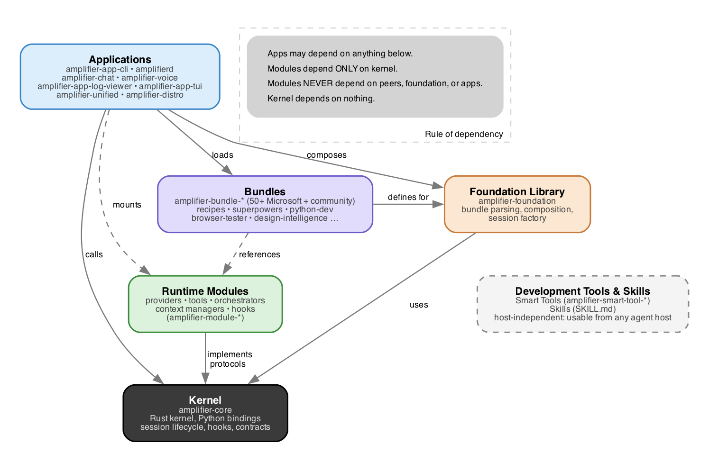

# Current Ecosystem

A verified inventory of what exists in the Amplifier ecosystem today: the kernel,
libraries, applications, bundles, runtime modules, Smart Tools, and community work.

> **Last reconciled: 2026-11-18** against
> [microsoft/amplifier `docs/MODULES.md`](https://github.com/microsoft/amplifier/blob/main/docs/MODULES.md)
> (the "Amplifier Component Catalog", upstream review date 2026-11-13) and GitHub
> repository metadata for the `microsoft` org.
>
> **What "listed" means here:** the repository is public and not archived. It is not
> a claim about support level, stability, or a released artifact. Where upstream
> flags something as experimental, preview, or early-ring, this page repeats the flag.
>
> **Categories are this site's own.** Upstream lists bundles in one flat table; the
> groupings below are editorial, for discovery.

---

## Architecture at a Glance



The dependency hierarchy is strictly one-directional. Apps depend on bundles,
foundation, modules, and the kernel. Bundles depend on foundation and modules.
Foundation depends on the kernel. Runtime modules depend **only** on the kernel --
never on each other, never on foundation, never on apps.

See [Architecture Boundaries](./08-architecture-boundaries.md) for the
boundary tests and rationale.

---

## What Changed Since May 2026

The ecosystem roughly doubled in public repositories between May and November 2026.
The shape of the growth matters more than the count:

| Change | What it means |
|--------|---------------|
| **Anchors is the default root bundle** | The upstream README now says Anchors is the default and calls `foundation` "a selectable complete root". Anchors lives inside `amplifier-foundation` (`bundles/anchors`), not in its own repo. CLI build `2026.09.06` reports `anchors (default)`; upstream `main` has since moved the default to `anchors-amp-dev`, a thin root that includes Anchors. |
| **Behaviors are the unit you add** | The quick start now adds a *behavior* to the existing host (`amplifier bundle add '...#subdirectory=behaviors/recipes.yaml' --app`) instead of switching root bundles. |
| **The kernel has more than Python bindings** | `amplifier-core` is described upstream as a native Rust kernel with Python bindings and Node/C-ABI interfaces in the same repository. Upstream notes that binding source being present does not establish released artifacts. |
| **Unified** | A local, authenticated web workspace for chat, voice, and work, with terminal and macOS clients. |
| **amplifier-agent** | An embeddable engine with Python/TypeScript bindings and HTTP and ACP faces, plus apps and automation built on it. |
| **Constellation** | Independent persistent agents speaking ACP, with a standalone Rust runtime that is separate from Core-loaded loop modules. |
| **Smart Tools** | A new packaging kind: a specification, a conformance kit, a catalog, and library-first CLIs any agent can use. |
| **Profiles and collections are formally deprecated** | Upstream now lists `amplifier-profiles`, `amplifier-collections`, `amplifier-config`, and the `amplifier-collection-*` repos under "Deprecated Components", replaced by bundles. |
| **Install command** | Upstream shows `uv tool install git+https://github.com/microsoft/amplifier` (no `@main`). |

---

## Tier 0: Kernel

| Repo | Role | Notes |
|------|------|-------|
| [`microsoft/amplifier-core`](https://github.com/microsoft/amplifier-core) | Kernel | Native Rust kernel for modular AI agent systems, with Python bindings and Node/C-ABI interfaces in the same repository. Provides session lifecycle, module protocols, hook registry, event dispatch, cancellation. |

The kernel defines five primary module protocols. See
[02-certainties.md](./02-certainties.md) for the contracts and
[the module-types diagram](../assets/diagrams/module-types.png) for the visual.

---

## Tier 1: Entry Point

| Repo | Role |
|------|------|
| [`microsoft/amplifier`](https://github.com/microsoft/amplifier) | User entry point. `uv tool install git+https://github.com/microsoft/amplifier` installs the reference CLI. Hosts the component catalog (MODULES.md), REPOSITORY_RULES.md, the user guides, and `BUNDLES_PROVIDERS_ROUTING_PROJECTS.md` (provider instances, routing, and settings scopes). |
| [`microsoft/amplifier-distro`](https://github.com/microsoft/amplifier-distro) | Curated distribution of Amplifier experiences, with its own installer. |
| [`microsoft/amplifier-docs`](https://github.com/microsoft/amplifier-docs) | Documentation for the Amplifier project. |

---

## Tier 2: Libraries

| Repo | Role |
|------|------|
| [`microsoft/amplifier-foundation`](https://github.com/microsoft/amplifier-foundation) | Foundational library for bundles, module resolution, and shared utilities. Also ships the `anchors` and `foundation` root bundles. Consumed by applications; **never** by runtime modules. |
| [`microsoft/amplifier-lib`](https://github.com/microsoft/amplifier-lib) | Python library for Amplifier. |
| [`microsoft/amplifier-module-resolution`](https://github.com/microsoft/amplifier-module-resolution) | Module resolution library. |
| [`microsoft/amplifier-lib-decisions`](https://github.com/microsoft/amplifier-lib-decisions) | *Experimental.* Optional typed contracts for bounded predicate, choice, and ordinal-score requests; no Core or Foundation dependency. |

---

## Tier 3: Applications

### Reference CLI and local daemon

| Repo | Role |
|------|------|
| [`microsoft/amplifier-app-cli`](https://github.com/microsoft/amplifier-app-cli) | Reference CLI application implementing the Amplifier platform. |
| [`microsoft/amplifierd`](https://github.com/microsoft/amplifierd) | Localhost HTTP daemon exposing `amplifier-core` and `amplifier-foundation` over REST and SSE. Drive sessions from any language or framework. |
| [`microsoft/amplifier-chat`](https://github.com/microsoft/amplifier-chat) | Browser-based chat UI plugin for amplifierd. |
| [`microsoft/amplifier-voice`](https://github.com/microsoft/amplifier-voice) | WebRTC voice plugin for amplifierd using the OpenAI Realtime API; standalone or as a plugin. |
| [`microsoft/amplifier-app-log-viewer`](https://github.com/microsoft/amplifier-app-log-viewer) | Web-based log viewer for debugging sessions with real-time updates. |
| [`microsoft/amplifier-app-acp`](https://github.com/microsoft/amplifier-app-acp) | ACP application for the full modular Amplifier runtime, built on amplifier-core and amplifier-foundation. |
| [`microsoft/amplifier-workspace`](https://github.com/microsoft/amplifier-workspace) | Workspace tool for the Amplifier project. |

### Unified

A local, authenticated workspace and web app for chat, voice, and work with your
configured bundles and tools.

| Repo | Role |
|------|------|
| [`microsoft/amplifier-unified`](https://github.com/microsoft/amplifier-unified) | The workspace and web app. Has its own installer; see the repo README. |
| [`microsoft/amplifier-unified-host`](https://github.com/microsoft/amplifier-unified-host) | AHP host coordinating ACP agents, sessions, admission, and subscriptions. |
| [`microsoft/amplifier-client-web`](https://github.com/microsoft/amplifier-client-web) | Browser interface: conversations, workspaces, tool activity, and interactive work surfaces. |
| [`microsoft/amplifier-app-tui`](https://github.com/microsoft/amplifier-app-tui) | *Prerelease.* Optional native terminal client for Unified, with an explicit standalone mode. |
| [`microsoft/amplifier-unified-client-tui`](https://github.com/microsoft/amplifier-unified-client-tui) | Terminal client for Amplifier Unified. |
| [`microsoft/amplifier-client-macos`](https://github.com/microsoft/amplifier-client-macos) | *Early public preview.* Native Mac client connecting to an existing Unified host. |
| `amplifier-unified-capability-*` | Host capabilities: [media](https://github.com/microsoft/amplifier-unified-capability-media), [native](https://github.com/microsoft/amplifier-unified-capability-native), [operations](https://github.com/microsoft/amplifier-unified-capability-operations), [resources](https://github.com/microsoft/amplifier-unified-capability-resources), [mcp](https://github.com/microsoft/amplifier-unified-capabilty-mcp). |
| Supporting repos | [`interop`](https://github.com/microsoft/amplifier-unified-interop), [`protocol-extensions`](https://github.com/microsoft/amplifier-unified-protocol-extensions), [`ahp-client-kit`](https://github.com/microsoft/amplifier-ahp-client-kit), [`portability`](https://github.com/microsoft/amplifier-portability), [`publishing`](https://github.com/microsoft/amplifier-publishing), [`session-catalog`](https://github.com/microsoft/amplifier-session-catalog). |

### amplifier-agent family

| Repo | Role |
|------|------|
| [`microsoft/amplifier-agent`](https://github.com/microsoft/amplifier-agent) | Public Python/TypeScript agent/session/turn bindings and an engine composing pinned Core, streaming-loop, context, provider, and tool components. HTTP and ACP faces serve other clients. |
| [`microsoft/amplifier-drumbeat`](https://github.com/microsoft/amplifier-drumbeat) | Automation engine for long-running agent sessions: an automation is a markdown file (schedule, notify policy, ordered steps) run unattended in a pinned agent session. |
| [`microsoft/amplifier-app-opencode`](https://github.com/microsoft/amplifier-app-opencode) | One-command launcher that configures the opencode TUI on top of amplifier-agent's OpenAI-compatible HTTP face. |
| [`microsoft/amplifier-app-nanoclaw`](https://github.com/microsoft/amplifier-app-nanoclaw) | Setup and integration for running NanoClaw with amplifier-agent as the agent backend. |
| [`microsoft/amplifier-app-paperclip`](https://github.com/microsoft/amplifier-app-paperclip) | Setup and integration for running paperclip agents on the Amplifier engine via amplifier-agent. |

### Constellation

Independent persistent agents. Start with the
[`amplifier-constellation`](https://github.com/microsoft/amplifier-constellation) repo
for the vision, component map, and shared contracts.

| Repo | Role |
|------|------|
| [`microsoft/amplifier-constellation-runtime`](https://github.com/microsoft/amplifier-constellation-runtime) | Standalone native Rust ACP engine with providers, durable sessions, and serial runtime tool dispatch. **Separate from Core-loaded loop modules.** |
| [`microsoft/amplifier-constellation-instance`](https://github.com/microsoft/amplifier-constellation-instance) | Independent installed agents with setup, profiles, authorized context, and management UI/API. |
| [`microsoft/amplifier-constellation-observatory`](https://github.com/microsoft/amplifier-constellation-observatory) | Fleet management and observation across machines. |
| [`microsoft/amplifier-constellation-conversations`](https://github.com/microsoft/amplifier-constellation-conversations) | Browser conversations for people and ACP agents with threads, permissions, and source context. |
| [`microsoft/amplifier-persona-workshop`](https://github.com/microsoft/amplifier-persona-workshop) | Communication and working-style profile authoring with portable AGENTS.md, SOUL.md, and native exports. |
| ACP adapters | [`acp-slack`](https://github.com/microsoft/amplifier-acp-slack), [`acp-teams`](https://github.com/microsoft/amplifier-acp-teams) (live tenant validation pending), [`acp-lab`](https://github.com/microsoft/amplifier-acp-lab), [`acp-minecraft`](https://github.com/microsoft/amplifier-acp-minecraft). |

### Evaluation, automation, and other apps

| Repo | Role |
|------|------|
| [`microsoft/amplifier-eval-harness`](https://github.com/microsoft/amplifier-eval-harness) | Test harness for evaluating bundles across scenarios and providers in isolated Digital Twin Universe environments, with timing and token breakdowns across the full session tree. |
| [`microsoft/amplifier-app-aiuser`](https://github.com/microsoft/amplifier-app-aiuser) | Reusable "AI User" that drives a lower-level AI session toward a goal across turns, then reports a verdict. |
| [`microsoft/amplifier-app-simulated-user-research`](https://github.com/microsoft/amplifier-app-simulated-user-research) | Automated product-audit rounds with real-browser persona sessions, synthesized into a findings spec behind a human gate. |
| [`microsoft/amplifier-app-actions`](https://github.com/microsoft/amplifier-app-actions) | GitHub Actions for automated issue triage and PR review. |
| [`microsoft/amplifier-browser-bridge`](https://github.com/microsoft/amplifier-browser-bridge) | Lets an agent on one machine drive the user's logged-in Microsoft Edge on other devices over their own Tailscale network. |
| [`microsoft/amplifier-context-intelligence`](https://github.com/microsoft/amplifier-context-intelligence) | Context Intelligence services. |
| [`microsoft/amplifier-app-repo-weaver`](https://github.com/microsoft/amplifier-app-repo-weaver), [`amplifier-app-wiki-weaver`](https://github.com/microsoft/amplifier-app-wiki-weaver) | Repo Weaver and Wiki Weaver apps. |
| [`microsoft/amplifier-app-openclaw`](https://github.com/microsoft/amplifier-app-openclaw) | OpenClaw skill for the Amplifier project. |
| [`microsoft/amplifier-converge`](https://github.com/microsoft/amplifier-converge) | Vision, collaboration contracts, and guides for people and agents leading larger bodies of work. Distinct from the executable Converge bundle. |
| [`DavidKoleczek/amplifier-app-benchmarks`](https://github.com/DavidKoleczek/amplifier-app-benchmarks) | Benchmarking and evaluating Amplifier. |

---

## Tier 4: Bundles

Bundles are composable configuration packages. They produce a Mount Plan that
`AmplifierSession` consumes. See [the bundle composition diagram](../assets/diagrams/bundle-composition.png).

Most bundles ship one or more **behaviors** (`behaviors/*.yaml`) that you add to
your existing host, alongside a root `bundle.md` you can select on its own.

### Workflows and methodology

| Bundle | What it adds |
|--------|--------------|
| [`recipes`](https://github.com/microsoft/amplifier-bundle-recipes) | Multi-step AI agent orchestration with behavior overlays and standalone options |
| [`superpowers`](https://github.com/microsoft/amplifier-bundle-superpowers) | TDD-driven brainstorm/plan/execute/verify/finish modes, agents, and a full development-cycle recipe |
| [`modes`](https://github.com/microsoft/amplifier-bundle-modes) | Dynamic runtime behavior overlays (brainstorm, debug, plan, verify, finish) |
| [`converge`](https://github.com/microsoft/amplifier-bundle-converge) | Vision-first, contract-driven development: ratified contracts, reconciliation ledger, owner-gated wave recipes |
| [`work`](https://github.com/microsoft/amplifier-bundle-work) | Provider-neutral live-host working bundle: delegation, compaction, transcript retrieval, filesystem/shell/search |
| [`work-tracker`](https://github.com/microsoft/amplifier-work-tracker) | Multi-agent work coordination with atomic claiming and PID-bound custody. Built on Beads. |
| [`issues`](https://github.com/microsoft/amplifier-bundle-issues) | Persistent issue tracking with dependency management and session linking |
| [`wayfinder`](https://github.com/microsoft/amplifier-bundle-wayfinder) | *Early-ring.* Curated in-session guidance and capability offers; proposes actions before running them |
| [`systems-design`](https://github.com/microsoft/amplifier-bundle-systems-design) | Systems-design capabilities for sessions |

### Orchestration and multi-agent

| Bundle | What it adds |
|--------|--------------|
| [`orchestration`](https://github.com/microsoft/amplifier-bundle-orchestration) | Event-driven primitives (bundle spawning, events, triggers) for multi-session coordination |
| [`observers`](https://github.com/microsoft/amplifier-bundle-observers) | Background observer sessions running in parallel with the main session |
| [`foreman`](https://github.com/payneio/amplifier-bundle-foreman) | A conversation assistant managing a fleet of assistants, each with its own session |
| [`a2a`](https://github.com/microsoft/amplifier-bundle-a2a) | Agent-to-Agent communication via the A2A protocol: discovery, trust, message routing |
| [`dot-runner`](https://github.com/microsoft/amplifier-bundle-dot-runner) | *Experimental.* DOT pipeline execution engine, CLI, unified LLM client, coding-agent loop, and amplifier-agent adapter |
| [`attractor`](https://github.com/microsoft/amplifier-bundle-attractor) | *Experimental.* Opinionated agents, bundles, and authoring guidance over Dot Runner's loops |

### Development tools

| Bundle | What it adds |
|--------|--------------|
| [`python-dev`](https://github.com/microsoft/amplifier-bundle-python-dev) | ruff, pyright, LSP, and an expert agent |
| [`rust-dev`](https://github.com/microsoft/amplifier-bundle-rust-dev) | cargo fmt, clippy, cargo check, LSP, and an expert agent |
| [`ts-dev`](https://github.com/microsoft/amplifier-bundle-ts-dev) | TypeScript/JavaScript code quality, LSP, and an expert agent |
| [`typescript-dev`](https://github.com/microsoft/amplifier-bundle-typescript-dev) | TypeScript linting, type checking, LSP |
| [`lsp`](https://github.com/microsoft/amplifier-bundle-lsp) | Core Language Server Protocol support |
| [`filesystem`](https://github.com/microsoft/amplifier-bundle-filesystem) | Filesystem tools (read, write, edit, glob, grep) |
| [`windows-shell`](https://github.com/microsoft/amplifier-bundle-windows-shell) | Native Windows shell support: a `pwsh` tool with PowerShell-shaped safety profiles |
| [`dot-graph`](https://github.com/microsoft/amplifier-bundle-dot-graph) | DOT/Graphviz knowledge, validation, rendering, and graph intelligence |

`ts-dev` and `typescript-dev` are both listed upstream as active. The deprecated
`lsp-typescript` stub forwards to `typescript-dev`.

### Testing and verification

| Bundle | What it adds |
|--------|--------------|
| [`browser-tester`](https://github.com/microsoft/amplifier-bundle-browser-tester) | Browser automation with operator, researcher, and visual-documenter agents |
| [`terminal-tester`](https://github.com/microsoft/amplifier-bundle-terminal-tester) | Terminal-app testing with screen-dump and PTY capture |
| [`android-tester`](https://github.com/microsoft/amplifier-bundle-android-tester) | Android app testing on emulators and devices via the accessibility tree |
| [`ios-tester`](https://github.com/microsoft/amplifier-bundle-ios-tester) | iOS app testing on simulators and devices |
| [`alexa-tester`](https://github.com/microsoft/amplifier-bundle-alexa-tester) | Alexa custom skill testing against a live skill endpoint |
| [`reality-check`](https://github.com/microsoft/amplifier-bundle-reality-check) | Intent-driven verification of built software in DTU environments |
| [`amplifier-tester`](https://github.com/microsoft/amplifier-bundle-amplifier-tester) | Validates Amplifier ecosystem changes in isolated DTU environments |
| [`evaluation`](https://github.com/microsoft/amplifier-bundle-evaluation) | An `evaluation` mode for designing evaluations plus a Python harness for running tasks in a DTU |

### Environments and infrastructure

| Bundle | What it adds |
|--------|--------------|
| [`digital-twin-universe`](https://github.com/microsoft/amplifier-bundle-digital-twin-universe) | On-demand isolated environments from declarative profiles (Incus containers) |
| [`execution-environments`](https://github.com/microsoft/amplifier-bundle-execution-environments) | Create, target, and destroy local, Docker, and SSH environments on demand |
| [`containers`](https://github.com/microsoft/amplifier-bundle-containers) | Container-based execution environments |
| [`shadow`](https://github.com/microsoft/amplifier-bundle-shadow) | OS-level sandboxed environments for testing local ecosystem changes |
| [`gitea`](https://github.com/microsoft/amplifier-bundle-gitea) | Ephemeral Gitea instances for isolated git workflows |
| [`distro`](https://github.com/microsoft/amplifier-bundle-distro) | Managed bundle for Amplifier distro |

### Computer and UI control

| Bundle | What it adds |
|--------|--------------|
| [`computer-use`](https://github.com/microsoft/amplifier-bundle-computer-use) | Computer Use bundle |
| [`ui-use`](https://github.com/microsoft/amplifier-bundle-ui-use) | *Experimental.* Bounded browser/computer controller with optional decision backends |

### Context, knowledge, and memory

| Bundle | What it adds |
|--------|--------------|
| [`skills`](https://github.com/microsoft/amplifier-bundle-skills) | Skills tool and a Microsoft-curated skills collection, as two composable behaviors |
| [`context-managed`](https://github.com/microsoft/amplifier-bundle-context-managed) | LLM-powered rolling summarization with persistent transcript and history recovery |
| [`context-intelligence`](https://github.com/microsoft/amplifier-bundle-context-intelligence) | Context Intelligence bundle |
| [`memory`](https://github.com/microsoft/amplifier-bundle-memory) | Local, Git-backed standing preferences with session integration. Distinct from the community memory capability. |
| [`llm-wiki`](https://github.com/microsoft/amplifier-bundle-llm-wiki) | The LLM Wiki pattern as workflow modes: init, ingest, lint, publish, query |
| [`team-pulse`](https://github.com/microsoft/amplifier-bundle-team-pulse) | Read-only lens over a team's shared knowledge via the Team Pulse API, with a mode and expert agent |
| [`redaction`](https://github.com/microsoft/amplifier-bundle-redaction) | Redaction library and redaction hook |

### Routing, content, design, and UX

| Bundle | What it adds |
|--------|--------------|
| [`routing-matrix`](https://github.com/microsoft/amplifier-bundle-routing-matrix) | Declarative model routing: 13 semantic roles, 7 curated matrices, CLI tooling |
| [`stories`](https://github.com/microsoft/amplifier-bundle-stories) | Storytelling engine: 11 specialist agents, 4 output formats, recipes |
| [`design-intelligence`](https://github.com/microsoft/amplifier-bundle-design-intelligence) | 7 design agents, a design philosophy framework, and a knowledge base |
| [`imagegen`](https://github.com/microsoft/amplifier-bundle-imagegen) | *Source candidate.* Composable image generation/editing tool and skill |
| [`my-voice`](https://github.com/microsoft/amplifier-bundle-my-voice) | Personalized voice and communication style |
| [`notify`](https://github.com/microsoft/amplifier-bundle-notify) | Desktop and push (ntfy.sh) notifications when assistant turns complete |

### Browser-hosted runtimes

| Bundle | What it adds |
|--------|--------------|
| [`browser`](https://github.com/microsoft/amplifier-bundle-browser) | Browser-hosted Amplifier runtime using Pyodide and a JavaScript facade. Not browser automation. |
| [`webruntime`](https://github.com/microsoft/amplifier-bundle-webruntime) | Web runtime for browser-based Amplifier |
| [`webllm`](https://github.com/microsoft/amplifier-bundle-webllm) | WebLLM with WebGPU for running amplifier-core in browsers |

### Deprecated

| Component | Replaced by |
|-----------|-------------|
| `amplifier-bundle-lsp-python` | [`python-dev`](https://github.com/microsoft/amplifier-bundle-python-dev) |
| `amplifier-bundle-lsp-rust` | [`rust-dev`](https://github.com/microsoft/amplifier-bundle-rust-dev) |
| `amplifier-bundle-lsp-typescript` | [`typescript-dev`](https://github.com/microsoft/amplifier-bundle-typescript-dev) |
| `amplifier-bundle-amplifier-online` | Owner-documented CLI and the `amplifier-online-deploy` skill workflow |
| `amplifier-profiles`, `amplifier-collections`, `amplifier-collection-toolkit` | Bundles |
| `amplifier-collection-design-intelligence` / `-issues` / `-recipes` | The matching `amplifier-bundle-*` |
| `amplifier-config` | Bundle configuration |

None of these are archived on GitHub; they are deprecated in the upstream catalog.

---

## Tier 5: Runtime Modules

Runtime modules implement the kernel's protocols. See
[the module-types diagram](../assets/diagrams/module-types.png).

### Orchestrators

| Module | Description |
|--------|-------------|
| [`loop-basic`](https://github.com/microsoft/amplifier-module-loop-basic) | Non-streaming request/response loop with parallel tool batches and ordered result insertion |
| [`loop-streaming`](https://github.com/microsoft/amplifier-module-loop-streaming) | Streaming loop with parallel tool batches, request budgeting, and optional cooperative suspension |
| [`loop-events`](https://github.com/microsoft/amplifier-module-loop-events) | Event-driven loop with sequential tool execution and optional scheduler veto or tool replacement |
| [`loop-live`](https://github.com/microsoft/amplifier-module-loop-live) | *Experimental.* Streaming-derived orchestrator for live inputs, request-boundary steering, and background jobs |

Upstream also documents orchestrators **embedded** in bundles rather than shipped as
module repos: Dot Runner's `loop-agent`, `loop-pipeline`, and `loop-amplifier-agent`,
and the `BrowserOrchestrator` in the `browser` and `webruntime` bundles.

### Providers

| Module | Description |
|--------|-------------|
| [`provider-anthropic`](https://github.com/microsoft/amplifier-module-provider-anthropic) | Anthropic Claude |
| [`provider-openai`](https://github.com/microsoft/amplifier-module-provider-openai) | OpenAI GPT |
| [`provider-openai-chatgpt`](https://github.com/microsoft/amplifier-module-provider-openai-chatgpt) | ChatGPT subscription backend via Codex CLI OAuth |
| [`provider-azure-openai`](https://github.com/microsoft/amplifier-module-provider-azure-openai) | Azure OpenAI with managed identity support |
| [`provider-chat-completions`](https://github.com/microsoft/amplifier-module-provider-chat-completions) | OpenAI Chat Completions wire format (llama.cpp, vLLM, LM Studio, LocalAI, ...) |
| [`provider-gemini`](https://github.com/microsoft/amplifier-module-provider-gemini) | Google Gemini with 1M context and thinking |
| [`provider-vllm`](https://github.com/microsoft/amplifier-module-provider-vllm) | vLLM server for self-hosted models |
| [`provider-ollama`](https://github.com/microsoft/amplifier-module-provider-ollama) | Local Ollama models |
| [`provider-github-copilot`](https://github.com/microsoft/amplifier-module-provider-github-copilot) | GitHub Copilot models via the Copilot SDK |
| [`provider-litellm`](https://github.com/microsoft/amplifier-module-provider-litellm) | LiteLLM for unified access to 100+ LLM providers |
| [`provider-mock`](https://github.com/microsoft/amplifier-module-provider-mock) | Mock provider for testing without API calls |

A provider **module** is not the same as a provider **instance**: one module can
back several configured instances, distinguished by `id`. See upstream
[BUNDLES_PROVIDERS_ROUTING_PROJECTS.md](https://github.com/microsoft/amplifier/blob/main/docs/BUNDLES_PROVIDERS_ROUTING_PROJECTS.md).

### Tools

| Module | Description |
|--------|-------------|
| [`tool-filesystem`](https://github.com/microsoft/amplifier-module-tool-filesystem) | Read, write, edit, list, glob |
| [`tool-bash`](https://github.com/microsoft/amplifier-module-tool-bash) | Shell command execution |
| [`tool-web`](https://github.com/microsoft/amplifier-module-tool-web) | Web search and content fetching |
| [`tool-search`](https://github.com/microsoft/amplifier-module-tool-search) | Code search (grep / glob) |
| [`tool-task`](https://github.com/microsoft/amplifier-module-tool-task) | Agent delegation and sub-session spawning |
| [`tool-todo`](https://github.com/microsoft/amplifier-module-tool-todo) | Self-accountability todo lists |
| [`tool-skills`](https://github.com/microsoft/amplifier-module-tool-skills) | Load domain knowledge from Anthropic-format skills |
| [`tool-mcp`](https://github.com/microsoft/amplifier-module-tool-mcp) | Model Context Protocol servers |
| [`tool-slash-command`](https://github.com/microsoft/amplifier-module-tool-slash-command) | Markdown-defined slash commands |
| [`tool-exec`](https://github.com/microsoft/amplifier-module-tool-exec) | Bounded JavaScript orchestration of already-mounted tools; requires host support, not a general shell |

### Context Managers

| Module | Description |
|--------|-------------|
| [`context-simple`](https://github.com/microsoft/amplifier-module-context-simple) | In-memory with automatic compaction |
| [`context-persistent`](https://github.com/microsoft/amplifier-module-context-persistent) | File-backed across sessions |

### Hooks

| Module | Description |
|--------|-------------|
| [`hooks-logging`](https://github.com/microsoft/amplifier-module-hooks-logging) | Unified JSONL event logging per session |
| [`hooks-redaction`](https://github.com/microsoft/amplifier-module-hooks-redaction) | Privacy redaction for secrets / PII |
| [`hooks-approval`](https://github.com/microsoft/amplifier-module-hooks-approval) | Interactive approval gates for sensitive operations |
| [`hooks-backup`](https://github.com/microsoft/amplifier-module-hooks-backup) | Automatic session transcript backup |
| [`hooks-streaming-ui`](https://github.com/microsoft/amplifier-module-hooks-streaming-ui) | Real-time console UI for streaming responses |
| [`hooks-status-context`](https://github.com/microsoft/amplifier-module-hooks-status-context) | Inject git status and datetime into agent context |
| [`hooks-todo-reminder`](https://github.com/microsoft/amplifier-module-hooks-todo-reminder) | Inject todo list reminders |
| [`hooks-scheduler-cost-aware`](https://github.com/microsoft/amplifier-module-hooks-scheduler-cost-aware) | Cost-aware model routing for event-driven orchestration |
| [`hooks-scheduler-heuristic`](https://github.com/microsoft/amplifier-module-hooks-scheduler-heuristic) | Heuristic model selection |
| [`hook-shell`](https://github.com/microsoft/amplifier-module-hook-shell) | Shell-based hooks, Claude Code format compatible |
| [`hooks-jev-decisions`](https://github.com/microsoft/amplifier-module-provider-jev) | *Experimental.* Optional Jev decision backend, registered as a hook/capability rather than a chat provider |
| [`hooks-local-decisions`](https://github.com/microsoft/amplifier-module-provider-local-decisions) | *Experimental.* Optional local decision-model backends exposed through a hook/capability |
| [`hooks-explanatory`](https://github.com/michaeljabbour/amplifier-module-hooks-explanatory) | Community. Inject educational ★ Insight blocks |

The two decision modules live in repos named `amplifier-module-provider-*` but
register as hooks, not chat providers.

See [the hook event flow diagram](../assets/diagrams/hook-event-flow.png) for how
events fan out to hook handlers and how action precedence resolves.

---

## Smart Tools and Skills

Smart Tools are a packaging kind that sits outside the bundle/module split: domain
expertise packaged as a tool any agent can use, typically a library-first CLI.

| Repo | Role |
|------|------|
| [`microsoft/amplifier-smart-tools`](https://github.com/microsoft/amplifier-smart-tools) | The Smart Tools specification, a machine-checkable conformance kit, and an authoring skill |
| [`microsoft/amplifier-smart-tools-catalog`](https://github.com/microsoft/amplifier-smart-tools-catalog) | Discoverable catalog with upstream manifest snapshots and provenance. Listing is not installation or qualification. |
| [`microsoft/amplifier-smart-tool-creator`](https://github.com/microsoft/amplifier-smart-tool-creator) | Scaffolds, validates, and reviews Smart Tools |
| [`microsoft/amplifier-smart-tool-digital-twin-universe`](https://github.com/microsoft/amplifier-smart-tool-digital-twin-universe) | Library-first CLI for isolated Docker Compose environments. Distinct from the DTU bundle. |
| [`microsoft/amplifier-smart-tool-reality-check`](https://github.com/microsoft/amplifier-smart-tool-reality-check) | Evidence-oriented app testing through browsers, desktops, or DTU environments. Not a CI/release gate. |
| [`microsoft/amplifier-smart-tool-team-pulse`](https://github.com/microsoft/amplifier-smart-tool-team-pulse) | Library-first CLI for a team's mined corpus with source-cited answers |
| [`microsoft/amplifier-smart-tool-tmux`](https://github.com/microsoft/amplifier-smart-tool-tmux) | Library-first CLI for observing tmux fleets and, under explicit confirmation, acting on sessions |
| [`microsoft/amplifier-drumpack-tmux`](https://github.com/microsoft/amplifier-drumpack-tmux) | Drumbeat drumpack placing the tmux Smart Tool on an automation's PATH |
| [`microsoft/amplifier-skill-revisioner`](https://github.com/microsoft/amplifier-skill-revisioner) | Skills for finding and testing risky assumptions in project visions |

---

## Community

Community components run arbitrary code with your permissions. Read the source
before installing. The upstream catalog is the authoritative list.

### Applications

| Repo | Description |
|------|-------------|
| [`robotdad/amplifier-app-transcribe`](https://github.com/robotdad/amplifier-app-transcribe) | Turn YouTube videos and audio files into searchable transcripts |
| [`robotdad/amplifier-app-blog-creator`](https://github.com/robotdad/amplifier-app-blog-creator) | Blog creation with style-aware generation and a markdown editor |
| [`robotdad/amplifier-app-voice`](https://github.com/robotdad/amplifier-app-voice) | Desktop voice assistant via the OpenAI Realtime API |
| [`samueljklee/amplifier-playground`](https://github.com/samueljklee/amplifier-playground) | Interactive environment for building, configuring, and testing sessions |
| [`payneio/lakehouse`](https://github.com/payneio/lakehouse) | Amplifier on top of your data (daemon and web app) |
| [`DavidKoleczek/amplifier-app-session-analyzer`](https://github.com/DavidKoleczek/amplifier-app-session-analyzer) | Analyze session logs and generate usage metrics |
| [`samueljklee/amplifier-app-tool-generator`](https://github.com/samueljklee/amplifier-app-tool-generator) | *Archived.* Tool generator, retained for reference |

### Bundles and capabilities

| Repo | Description |
|------|-------------|
| [`colombod/amplifier-bundle-deepwiki`](https://github.com/colombod/amplifier-bundle-deepwiki) | Ask questions about any public GitHub repository via DeepWiki MCP |
| [`colombod/amplifier-bundle-perplexity`](https://github.com/colombod/amplifier-bundle-perplexity) | Deep web research via Perplexity's Agentic Research API |
| [`colombod/amplifier-bundle-tui-tester`](https://github.com/colombod/amplifier-bundle-tui-tester) | AI-assisted testing for TUI applications |
| [`colombod/amplifier-bundle-web-ux-dev`](https://github.com/colombod/amplifier-bundle-web-ux-dev) | Visual regression testing, console debugging, pre-commit verification |
| [`samueljklee/amplifier-bundle-browser`](https://github.com/samueljklee/amplifier-bundle-browser) | Browser automation for agents using agent-browser. Not the Microsoft `browser` bundle. |
| [`bkrabach/amplifier-bundle-parallax-discovery`](https://github.com/bkrabach/amplifier-bundle-parallax-discovery) | Multi-agent deep investigation in progressive waves |
| [`johannao76/amplifier-bundle-codebase-to-course`](https://github.com/johannao76/amplifier-bundle-codebase-to-course) | Turn a codebase into a self-contained interactive HTML course |
| [`DavidKoleczek/amplifier-expert-cookbook`](https://github.com/DavidKoleczek/amplifier-expert-cookbook) | Expert cookbook for Amplifier |
| [`robotdad/frontdoor`](https://github.com/robotdad/frontdoor) | Authentication gateway and service dashboard for Tailscale-based hosts |
| [`michaeljabbour/amplifier-capability-memory`](https://github.com/michaeljabbour/amplifier-capability-memory) | Evidence/fact memory capability with a portable skill. Formerly `amplifier-bundle-memory`. |
| [`michaeljabbour/amplifier-capability-research`](https://github.com/michaeljabbour/amplifier-capability-research) | Research capability and portable skill for evidence-linked decisions, experiments, and papers |
| [`michaeljabbour/amplifier-capability-long-read`](https://github.com/michaeljabbour/amplifier-capability-long-read) | Long-document capability with bounded evidence retrieval. Formerly `amplifier-module-tool-rlm`. |
| [`michaeljabbour/amplifier-bundle-taste`](https://github.com/michaeljabbour/amplifier-bundle-taste) | Anti-slop frontend design discipline |

### Modules

| Repo | Type | Description |
|------|------|-------------|
| [`brycecutt-msft/amplifier-module-provider-bedrock`](https://github.com/brycecutt-msft/amplifier-module-provider-bedrock) | Provider | AWS Bedrock with cross-region inference for Claude models |
| [`colombod/amplifier-module-provider-perplexity`](https://github.com/colombod/amplifier-module-provider-perplexity) | Provider | Perplexity chat completions with sonar models |
| [`robotdad/amplifier-module-provider-openai-realtime`](https://github.com/robotdad/amplifier-module-provider-openai-realtime) | Provider | OpenAI Realtime API for speech-to-speech |
| [`robotdad/amplifier-youtube`](https://github.com/robotdad/amplifier-youtube) | Tool | YouTube download, search, and account feed access |
| [`robotdad/amplifier-module-tool-whisper`](https://github.com/robotdad/amplifier-module-tool-whisper) | Tool | Speech-to-text via OpenAI's Whisper API |
| [`robotdad/amplifier-module-image-generation`](https://github.com/robotdad/amplifier-module-image-generation) | Tool | Multi-provider image generation |
| [`robotdad/amplifier-module-style-extraction`](https://github.com/robotdad/amplifier-module-style-extraction) | Tool | Extract and apply writing style from samples |
| [`robotdad/amplifier-module-markdown-utils`](https://github.com/robotdad/amplifier-module-markdown-utils) | Tool | Markdown parsing, injection, and metadata utilities |
| [`obra/amplifier-module-hooks-concise-display`](https://github.com/obra/amplifier-module-hooks-concise-display) | Hook | Cleaner, more condensed terminal output |
| [`samueljklee/amplifier-module-hooks-compact`](https://github.com/samueljklee/amplifier-module-hooks-compact) | Hook | Compress verbose bash output before it enters the LLM context |

---

## What a Real Install Looks Like

For the packaging kinds (module, bundle, behavior, Smart Tool, capability) and a
worked example of what one long-running install composes, see
[A Working Setup](./15-a-working-setup.md).

---

## Diagrams

All diagrams in this site are generated from DOT source files committed alongside
the rendered output. To regenerate after edits:

```bash
cd assets/diagrams
for f in *.dot; do
  name="${f%.dot}"
  dot -Tpng -Gdpi=144 "$f" -o "${name}.png"
  dot -Tsvg "$f" -o "${name}.svg"
done
```

| Diagram | What it shows |
|---------|----------------|
| `architecture-stack` | The five tiers and the strict dependency direction |
| `module-types` | The five primary kernel module protocols |
| `dependency-rules` | Allowed (green) and forbidden (red) imports across repo types |
| `session-lifecycle` | Bundle load -> mount -> session ready -> execute -> teardown |
| `bundle-composition` | The thin-bundle pattern with foundation + a behavior overlay |
| `hook-event-flow` | Event fan-out to hook handlers and HookResult precedence |

---

## Verifying Counts and Names

Whenever this document is quoted publicly:

1. Open [`microsoft/amplifier/docs/MODULES.md`](https://github.com/microsoft/amplifier/blob/main/docs/MODULES.md)
2. Reconcile the application / bundle / module / Smart Tool lists
3. Update this document and the "Last reconciled" date if anything has shifted

The upstream catalog is the source of truth; this document is a curated mirror
designed for discovery, not a substitute for the upstream list. Some repositories
listed here (the `amplifier-unified-*` family and a few supporting libraries) were
public but not yet in the upstream catalog on the reconciliation date; their
descriptions come from the repositories themselves.

---

**Previous:** [Ecosystem Quick Map](./09-ecosystem-quick-map.md)
**Next:** [Working with AI](./13-working-with-ai.md)
